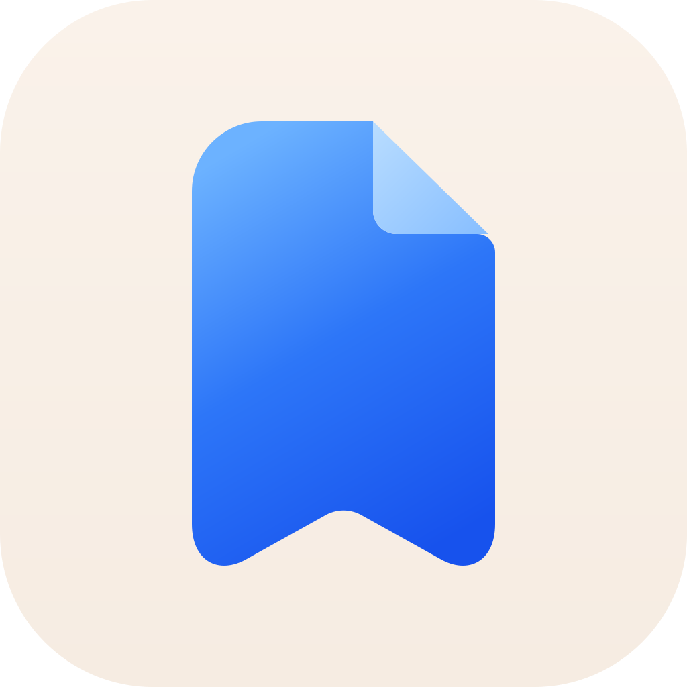
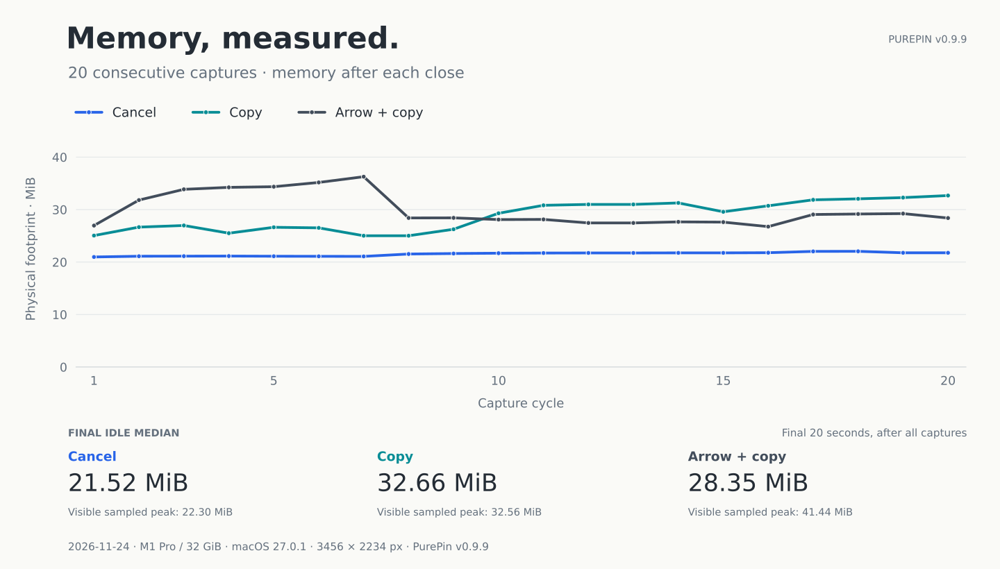
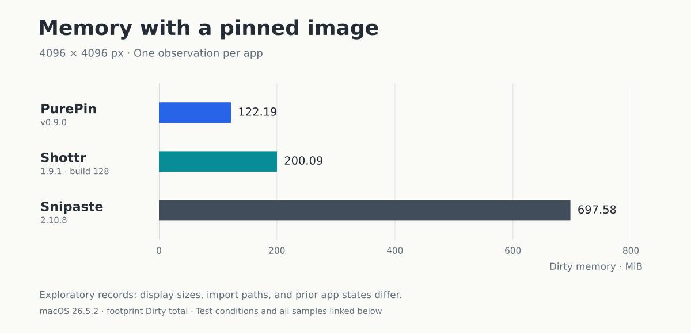

# PurePin

### Capture. Edit. Pin.

A small, native screenshot app for macOS.

English · [简体中文](README.zh-CN.md)

For those tired of signing in, dismissing upgrade prompts, 
and digging through features just to take a screenshot.

 

| Capture | Edit | Pin |
| :--- | :--- | :--- |
| Capture a region, a window area, or the whole screen across displays. Pick live `#RRGGBB` colors with the magnifier and adjust selections down to the pixel. | Annotate a capture or clipboard image with shapes, arrows, text, freehand strokes, blur, and mosaic. Undo and redo as you go. | Keep a screenshot or clipboard image on top with transparent background support. Move, resize, adjust opacity, hide, restore, or jump back into editing. |

No account or cloud history. Screenshots and image processing stay on your Mac. [Privacy →](PRIVACY.md)

## Memory

Three scenarios, 20 captures each. Median memory use during the final 20 seconds of idle time: **21.5–32.7 MiB**.

Measured with an instrumented Release build. The chart shows memory after each capture closes; the highest samples while capturing were 22–41 MiB. [Method and data →](docs/memory-report.md)

### Pinning a large image: PurePin, Shottr, Snipaste

A 4096 × 4096 px color test image, pinned on screen. One observation per app, using the versions shown below.

Measured as total Dirty memory in macOS `footprint`. Display sizes, import paths, and prior app states differed, so treat these as exploratory observations. [Conditions and full records →](docs/competitor-memory-observations.md)

## Download

[Download PurePin →](https://github.com/easyrev/PurePin/releases)

**macOS 26+** · Apple Silicon / Universal (Apple Silicon + Intel)

## Installation and first launch

Open the DMG, drag PurePin to Applications, and open it from there. For a release marked **not notarized**, macOS may block the first launch. After attempting to open PurePin, go to **System Settings → Privacy & Security**, find the message about PurePin near the bottom, and choose **Open Anyway**. Confirm the system prompt. See [Apple's instructions](https://support.apple.com/102445).

On first launch, PurePin shows screen capture setup if permission is missing. Choose **Allow Screen Recording** and finish the macOS prompt. If needed, **Open System Settings** takes you to **Privacy & Security → Screen & System Audio Recording**. Enable PurePin; quit and reopen it if macOS asks. Once setup says you're ready, choose **Done**, then press **F1** yourself. Setup does not start or queue a screenshot.

PurePin uses this permission for still screenshots. It does not record audio or require Accessibility, Camera, or Microphone access.

## Shortcuts

| Action | Default shortcut |
| :--- | :--- |
| Start a capture | <kbd>F1</kbd> |
| Edit an image from the clipboard | <kbd>⌥</kbd> + <kbd>F1</kbd> |
| Pin an image from the clipboard | <kbd>F3</kbd> |
| Hide / restore all pins | <kbd>⇧</kbd> + <kbd>F3</kbd> |
| Copy the pixel color under the magnifier | <kbd>C</kbd> |
| Select the full display | <kbd>⌘</kbd> + <kbd>A</kbd> |
| Copy the capture and finish editing | <kbd>Return</kbd>, <kbd>⌘</kbd> + <kbd>C</kbd>, or double-click inside |
| Pin the current capture | <kbd>⌘</kbd> + <kbd>T</kbd> |
| Save a PNG | <kbd>⌘</kbd> + <kbd>S</kbd> |
| Adjust stroke width, font size, or blur/mosaic strength | <kbd>[</kbd> / <kbd>]</kbd> or scroll wheel |
| Undo / redo | <kbd>⌘</kbd> + <kbd>Z</kbd> / <kbd>⇧</kbd> + <kbd>⌘</kbd> + <kbd>Z</kbd> |

If macOS uses the function keys for system controls, hold <kbd>fn</kbd> / Globe, choose another shortcut, or clear any global shortcut in Settings.

Before locking a capture region, move the pointer across displays to switch screens, or right-click to step back and unlock an empty selection. Hold <kbd>Shift</kbd> while dragging to constrain squares and 45° lines or arrows.

To annotate an existing image, copy the image itself or copy an image file (including PNG, JPEG, HEIC, WebP, and TIFF) in Finder, then choose **Edit Clipboard Image** from the menu bar. Hold <kbd>Space</kbd> to pan and zoom up to 16×; zooming and panning only change the view, while copying, saving, and pinning preserve the original pixel dimensions unless you crop the image. Clipboard editing does not require screen recording permission.

Drag a pin to move it, nudge it with arrow keys, scroll or pinch to resize it, hold <kbd>⌥</kbd> while scrolling to adjust opacity, and double-click to close it. Right-click or press <kbd>⌘</kbd> + <kbd>E</kbd> to copy, save, restore original size or opacity, or reopen the pin in the editor.

---

[Download](#download) · [Privacy](PRIVACY.md) · [Help & feedback](SUPPORT.md)

PurePin is currently closed source. This repository hosts downloads and feedback. Copyright © 2026 PurePin.

