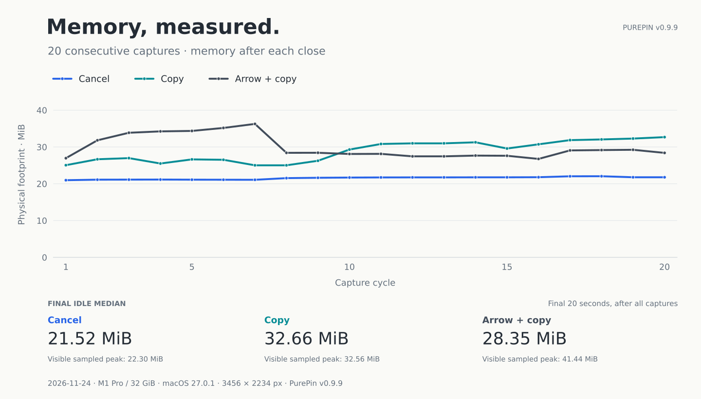

# Memory, measured.

English · [简体中文](memory-report.zh-CN.md)

Three separate sessions of 20 captures: cancel, copy, and add an arrow then copy. Median process memory during the final 20 seconds of idle time was **21.52–32.66 MiB**.



These measurements use an instrumented Release build. They describe the tested scenarios, not a fixed memory budget for the standard release or a product ranking.

## Setup

| Condition | Recorded value |
| :--- | :--- |
| Date | November 24, 2026 |
| Machine | Apple M1 Pro, 32 GiB, arm64 |
| System | macOS 27.0.1, build 26A434 |
| Toolchain | Xcode 27.2 (27B52), macOS SDK 27.2 |
| App | PurePin v0.9.9, Release with `PUREPIN_BENCHMARK` |
| Source | `f169eca4b3c5bac54680a9b0b1de4cd0beced9d2`, clean build |
| Display | 1728 × 1117 points, 3456 × 2234 pixels, 2× |
| Input | Real capture of the built-in display; programmatic selection at roughly 60% of its width and height; one arrow in the annotation scenario |
| Sessions | One fresh process per scenario, 20 cycles per process |
| Timing | 8 seconds idle after launch; 1 second visible and 6 seconds closed per cycle; 20 seconds idle after all cycles |
| Sampling | `task_vm_info.phys_footprint`, approximately every 100 ms |

**MiB = 1,048,576 bytes.** The metric is process physical footprint, not RSS or total system memory cost. Each plotted point is the last sample in that cycle's closed phase. All 20 points are shown without smoothing.

## Results

All values are MiB.

| Scenario | Initial idle median | Last five closed cycles: median (range) | Final idle median | Highest visible sample |
| :--- | ---: | ---: | ---: | ---: |
| Cancel | 16.64 | 21.78 (21.77–22.05) | 21.52 | 22.30 |
| Copy | 16.64 | 32.05 (30.72–32.67) | 32.66 | 32.56 |
| Arrow + copy | 16.74 | 29.06 (26.75–29.24) | 28.35 | 41.44 |

The visible values are sampled maxima, not kernel-recorded lifetime peaks. Final idle medians come from the last 20-second observation period, not the 20 plotted points.

First-five to last-five closed-cycle medians were 21.11→21.78, 26.63→32.05, and 33.86→29.06 MiB. These records show bounded behavior over the 20 measured cycles and do not establish a universal upper bound.

All 60 cycles passed output-completeness and resource-release checks at the specified samples. At +1 second, +5 seconds, the last closed sample of each cycle, and the final idle samples, the editor, editor view, and in-flight work had ended. Copy scenarios also checked clipboard changes and PNG output. The Pin count was zero throughout.

## Limits

Each scenario has one process session; 20 cycles within it are not 20 independent experiments. The tests captured the real desktop without a fixed public input image shared across scenarios. Hardware, system version, resolution, and screen content can affect the results.

This run did not cover long mixed workloads, live pins, multiple displays, sleep/wake, severe memory pressure, or physical-key-to-frame latency. An instrumented Release differs from the distribution binary. These measurements cannot establish a fixed memory ceiling, absence of leaks, or superiority over other products.

`leaks` reported roughly 22 KiB of candidates and warned that the target was not debuggable and memory access was restricted. Passing application-object release checks does not rule out every leak. Earlier records on September 12 and September 21 used different system and toolchain versions; they are not a controlled before/after comparison.

## Data and chart

[Sanitized JSON](data/memory-2026-11-24.json) contains all 60 plotted values, statistics, build identity, conditions, and SHA-256 hashes of the original files. Values were checked against local CSV and summary records. It excludes desktop pixels, personal paths, and heap dumps. This derived dataset supports checking the chart but does not replace the complete raw samples.

The [renderer](../script/render_memory_report.py) uses Matplotlib. With `matplotlib==3.10.8` installed, run:

```sh
python script/render_memory_report.py
```

Add `--png /tmp/purepin-memory.png` for a PNG preview. This regenerates the figure; it does not run benchmarks. The public repository does not contain application source or internal sampling entry points.

[Back to PurePin](../README.md)
